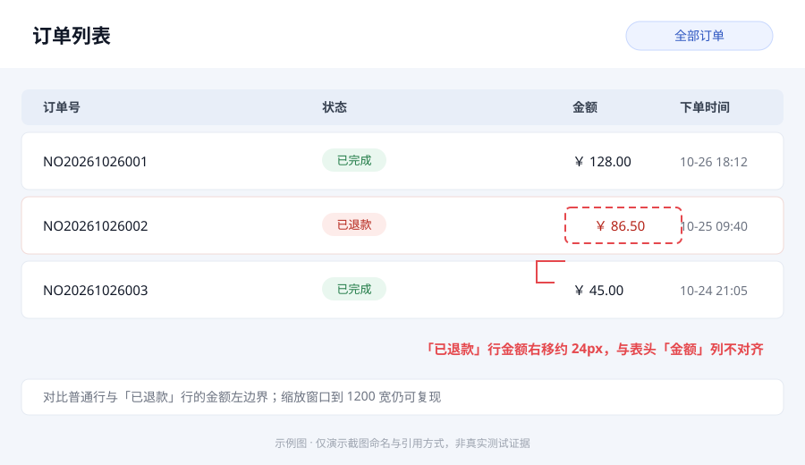

# P1-订单列表-已退款行金额列错位-待修复

| 字段 | 内容 |
| --- | --- |
| 问题编号 | BUG-20261026-001 |
| 发现轮次 | 首轮 |
| 发现时间 | 2026-10-26 18:40 |
| 执行端 / 环境 | Web / Chrome 129 / Windows 11，1440 宽 |
| 测试环境 / 账号 | https://test.example.com / 账号 test_buyer_01（密码见群公告，不入报告） |
| 对应用例 | ORDER-046（用例优先级 P1） |
| 复现概率 | 必现（3/3） |
| 当前状态 | 待修复 |

## 问题级别

**P1（严重）**

判定依据：金额列与表头错位，用户会把相邻订单的金额读成另一行，属于核心列表信息错误，违反 ORDER-046 的验收标准；列表仍可滚动操作，因此定 P1 而非 P0。

## 文件目录

- 端：Web / Chrome 129
- 页面或接口：/order/list
- 源码文件：src/views/order/OrderList.vue:433
- 测试用例：testcase/2026-10-26-订单列表测试用例.csv / ORDER-046

## 问题描述

订单列表中，带「已退款」标签的行，金额文本整体右移约 24px，与表头「金额」列和其他行对不齐，容易读成相邻行的数值。

### 复现步骤

1. 以测试账号登录，进入订单列表页。
2. 切换到「全部订单」，找到一条带「已退款」标签的订单。
3. 对比该行金额文本与表头「金额」列的左边界，再与普通行对比。

### 复现条件

- 账号 / 角色：已登录的普通买家账号
- 测试数据：至少一条已退款订单，且退款时间在近 7 天内
- 环境 / 机型：Chrome 129 / Windows 11 / 1440 宽
- 复现概率：必现（3/3）

## 预期结果

金额列在所有行左对齐，与表头「金额」列保持一致；标签不挤压金额列的起始位置。

## 实际结果

带「已退款」标签的行，金额文本右移约 24px，与表头错位；普通行正常。缩放窗口到 1200 宽仍可复现。

## 初步定位

**责任方：前端**

判定依据：抓包 `GET /api/orders` 返回该笔订单 `amount: 86.5`、`status: REFUNDED`，字段与排序都与设计一致；普通行金额左边界是 640px，该行因为「已退款」标签撑宽容器，金额列整体右移 24px，源码 `src/views/order/OrderList.vue:433` 的金额列没有固定宽度。

建议下一步：前端检查 `OrderList.vue` 金额列宽度与标签容器的 flex 约束，不要靠给标签限宽来掩盖。

排除项：接口返回的金额、状态、排序均正确，排除后端数据问题。

## 问题截图

图1：红框处为「已退款」行金额文本相对表头的偏移。示例图使用 SVG 仅演示格式，非真实测试证据；实际报告按规范保存 PNG。

## 补充信息

- 相关样式：标签宽度变化时金额列没有固定宽度（初步排查，待开发确认）。
- 关联用例：ORDER-047（长昵称不挤压金额列）需一并回归。
